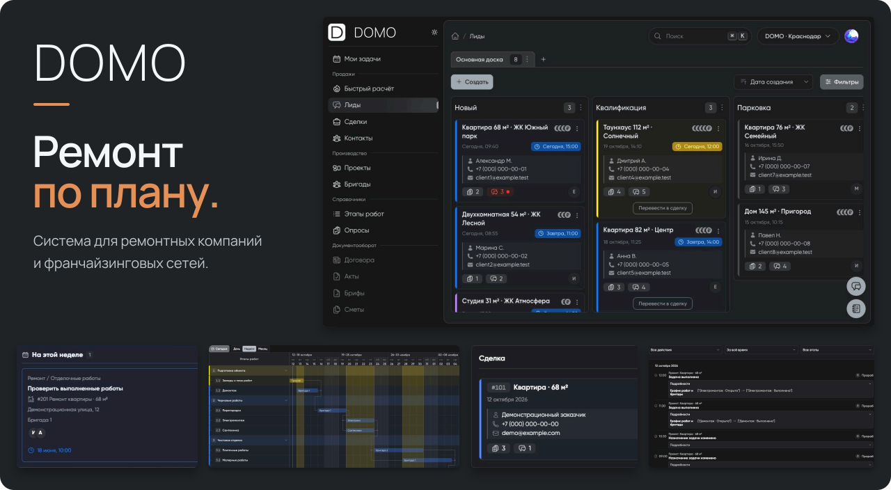

  <picture>
    <source media="(max-width: 640px)" srcset="assets/banner-mobile-b8f1b23b82e9.svg">
    
  </picture>

# DOMO

**Цифровая платформа для ремонтных компаний и франчайзинговых сетей.**

Сайт: [domo-frn.ru](https://domo-frn.ru)

Объединяем обращения клиентов, продажи, планирование проектов и работу команды в одной системе. Помогаем видеть весь процесс: от первой заявки до работ на объекте.

### Возможности платформы

| Работа с клиентами | Управление проектами |
| :--- | :--- |
| Принимайте заявки, ведите лиды и сделки, планируйте следующие действия. | Планируйте этапы и сроки работ, назначайте бригады и ответственных. |
| **Совместная работа** | **Управление франшизой** |
| Работайте с задачами, обсуждениями, файлами и историей проекта в одном месте. | Каждая компания получает своё рабочее пространство в общей системе франчайзинговой сети. |

### Наш подход

- **Для ремонтного бизнеса.** Процессы и инструменты учитывают повседневную работу ремонтных компаний.
- **Связанные этапы.** Данные клиента сохраняются при переходе от заявки к сделке и проекту.
- **Понятная ответственность.** Команда видит задачи, сроки и ответственных за следующий шаг.
